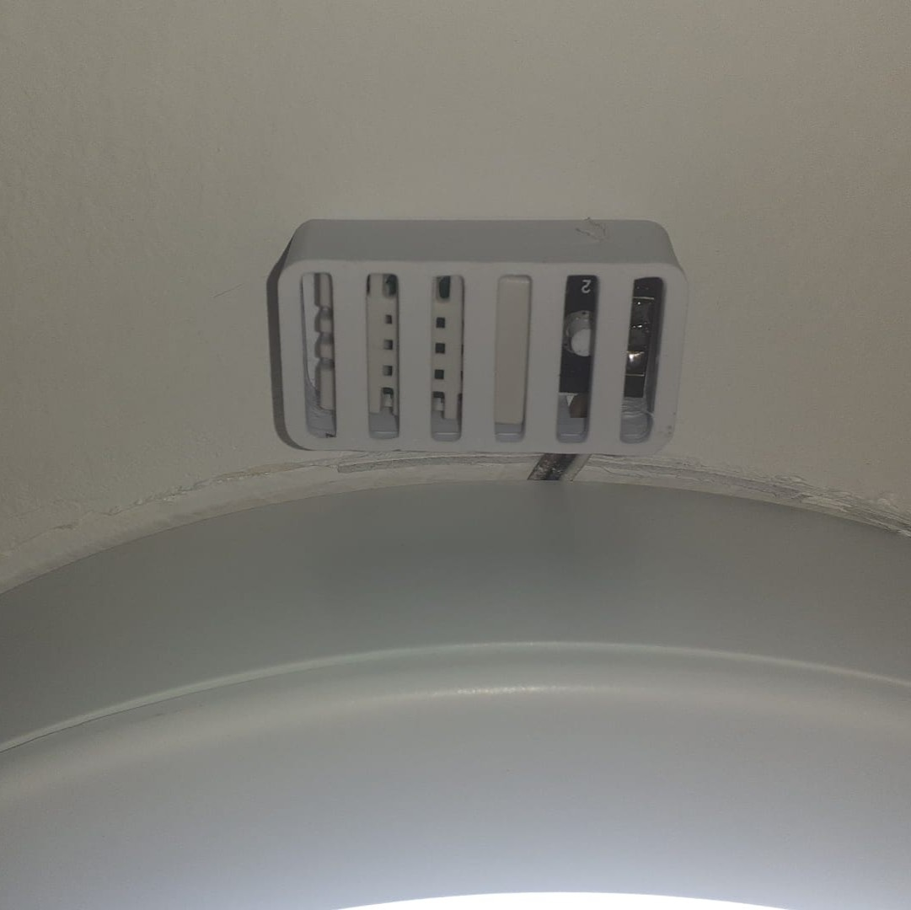
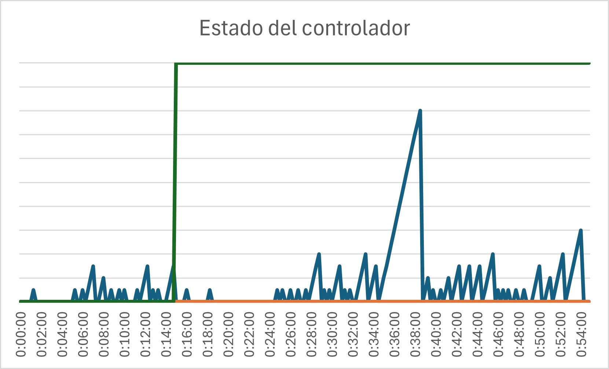
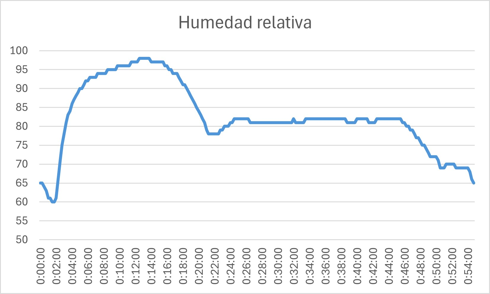
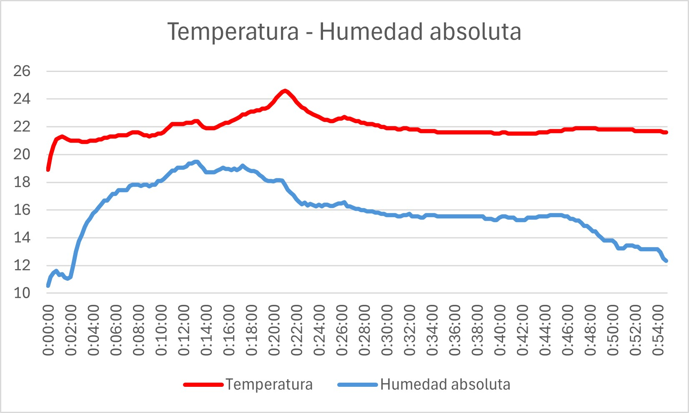
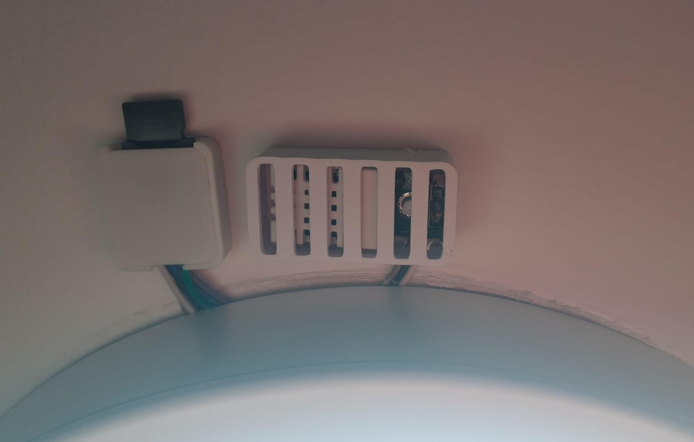

# Controlador autónomo para extractor de humedad

Este proyecto nació a partir de un problema muy común en los baños domésticos. Los extractores de humedad suelen conectarse en paralelo con el alumbrado principal, de modo que se activan automáticamente cada vez que alguien enciende la luz. Aunque es una solución sencilla, tiene un inconveniente evidente: el extractor funciona siempre, independientemente de si realmente es necesario.

En mi caso decidí modificar la instalación para que el extractor pudiera accionarse manualmente mediante un interruptor independiente, sustituyendo el interruptor simple existente por uno doble.

La siguiente mejora consistió en instalar un relé temporizado a la desconexión ajustado a 30 minutos. Esto resolvía el problema de olvidarse de apagar el extractor, pero introducía otro distinto: un tiempo fijo rara vez es el adecuado. En ocasiones el baño recuperaba unas condiciones normales en pocos minutos y el extractor continuaba funcionando innecesariamente. En otras, tras una ducha prolongada, treinta minutos resultaban insuficientes para eliminar la humedad.

El objetivo pasó entonces a ser desarrollar un temporizador cuya duración dependiese del estado real del ambiente y no únicamente del tiempo transcurrido.

El proyecto consiste en el diseño de un controlador basado en Arduino capaz de gestionar automáticamente un extractor de humedad utilizando medidas de temperatura y humedad. El sistema mantiene el extractor en funcionamiento el tiempo necesario para reducir la humedad ambiental por debajo de unos umbrales configurables, evitando tanto un funcionamiento insuficiente como un consumo innecesario.

## Diseño

Desde el principio se priorizó la robustez del sistema frente a la complejidad. Los sensores de humedad de bajo coste tienden a producir lecturas erróneas, quedar bloqueados o incluso dejar de responder, especialmente en ambientes cálidos y húmedos como un cuarto de baño. Esto es especialmente relevante en condiciones en las que la humedad tiende a condensar (es decir, que el sensor se encuentre a temperatura de rocío). Por ese motivo el controlador se diseñó siguiendo un principio sencillo: ante cualquier condición anómala, el sistema debe adoptar un comportamiento predecible y seguro.

Para conseguirlo se implementaron distintos mecanismos de protección:

* filtrado de medidas mediante mediana (elimina la mayoría de outliers)
* detección de valores fuera de rango (elimina lecturas erróneas pero validadas por el sensor)
* control de tiempo de respuesta (mide el tiempo de respuesta del sensor para detectar degradación)
* detección de sensor congelado (asegura que el sensor toma medidas reales y no repetidas)
* recuperación automática mediante watchdog (incluye aviso por reinicio automático)
* modo seguro ante fallos persistentes (intento de recuperación; en caso de fallo persistente, apagado automático)
* apagado definitivo cuando no puede garantizarse un funcionamiento fiable (o cuando termina el ciclo de funcionamiento)

El esquema de la máquina de estados está disponible aquí: [Máquina de estados](docs/Programa_Arduino_(UML).pdf). 
El programa completo para Arduino IDE está en: [Programa](firmware/Programa.ino)

Además, el sistema nunca sustituye el control manual del usuario. El extractor continúa estando gobernado en última instancia por el interruptor de la instalación, de modo que siempre puede desconectarse manualmente independientemente del estado del controlador.

## Comentarios de diseño [^1]

Hay algunas decisiones de diseño del código que requieren una explicación más exhaustiva.

Las medidas de seguridad implementadas deberían ser suficientes para su uso habitual. Además, estas medidas son las que aparecen indicadas en el apartado de [Diseño](#diseño). Todas las demás características no buscan aumentar la seguridad, sino simplemente obtener un funcionamiento más adecuado al uso. Este es el caso del contador de tiempo máximo. Aunque a primera vista podría parecer un contador de seguridad, para asegurar el apagado, en realidad no hay ningún motivo por el que apagar el sistema tras un tiempo fijo aumente de alguna manera la seguridad. Su única función es reducir el nivel de ruido en casa (no olvidemos que es un extractor en un baño doméstico). No es una crítica aceptable indicar que, en algunas condiciones muy específicas, el reinicio del temporizador (que ocurre cuando la humedad aumenta de nuevo) pueda provocar un funcionamiento indefinido del aparato. El extractor deberá ventilar mientras haya un motivo para ello, es decir, que si la humedad aumenta idefinidamente, el extractor funcionará indefinidamente. En cualquier caso, la humedad no puede —físicamente— aumentar indefinidamente. Sólo se considera aumento cuando el porcentaje aumenta a partir del 80%, por lo que la cantidad de ciclos que se pueden repetir entre el 80 y el 100 es limitada. En cualquier caso, el funcionamiento indefinido, aunque imposible, sí que sería deseable.

Otro caso posiblemente polémico es el contador de sensor congelado. En un ambiente estable, este contador puede concluir que el sensor está congelado (no cambia sus medidas) aunque las medidas sean perfectamente correctas y válidas. Es un caso posible, pero desde luego no aplica en este caso. La humedad y la temperatura cambian, entre otras cosas, con el flujo de aire, y un extractor de humedad busca precisamente mover el aire. Aunque es una crítica válida si se está diseñando una estación meteorológica, en este controlador la humedad no debería permanecer constante nunca (a no ser, claro está, que no haya ningún motivo por el que el extractor debiera estar encendido, es decir, que la humedad en el interior es la misma que en el exterior del baño). Así, aparecen varias posibilidades reales:

- El extractor no está funcionando y la humedad no baja, por lo que no es deseable que permanezca activado.
- El extractor está encendido pero el sensor está congelado, por lo que tampoco es deseable que el controlador permanezca activado.
- El extractor está funconando pero el aire que entra en el baño tiene las mismas características que el que sale. Es una posiblidad anormal, pero es este caso tampoco debería estar funcionando el sistema.
- El extractor está funcionando correctamente y se está generando exactamente la misma cantidad de vapor. Es una posibilidad teórica, más rara si cabe que la anterior, pero experimentalmente descartada.

El watchdog también es un punto delicado del programa. Por un lado, una crítica más que razonable es que no hay ninguna herramienta que impida reinicios consecutivos. Es un caso remoto, pues aunque nunca debería ocurrir un reinicio por watchdog (el código no lo permite), un fallo externo al programa, como podría ser un daño en el hardware, podría desencadenar una serie de reinicio tras reinicio que no tendrían ningún final programado. Es una posibilidad remota, pero real. Por otro lado, puede parecer que un reinicio automático tiende a encender de nuevo el relé, es decir, que tiene una especie de comportamiento Fail ON. No es el caso. El watchdog solamente puede actuar mientras el relé ya está activado en funcionamiento normal (antes o después se encuentra desactivado). Es decir, que cuando el watchdog ordena un reinicio, el relé ya estaba encendido, no lo enciende el guardián. Nunca se da el caso de que un relé apagado se encienda de nuevo por culpa del watchdog.

El diseño del esquema eléctrico también es cuestionable si no se explica adecuadamente.

Ignorando todas las especificaciones que faltan y que no conozco (cada uno deberá utilizar los componentes exactos que considere más adecuados), existe la posibilidad de criticar normativamente el diseño. Es una crítica que nace del desconocimiento. El REBT (la norma suprema en instalaciones eléctricas españolas) indica qué instalaciones pueden y no pueden llevarse a cabo en un baño, y con qué condiciones. Es la única parte del reglamento que puede considerarse de aplicación (más adelante se indica por qué). La ITC-BT-27 es la que aplica, pero no tiene demasiado sentido cuestionarla en este caso. La instalación del sensor, el controlador y el relé no se encuentran en cualquier volúmen, sino que están en el mismo que la luminaria. El proyecto se basa en la presunción de que la instalación preexistente cumple con el reglamento (como, efectivamente, es el caso). Incluso si no fuera así, este aspecto normativo quedaría fuera del alcance de este proyecto. 

Por otro lado, el reglamento electrotécnico establece, en su Artículo 2, apartado 2, los casos en los que será de obligado cumplimiento. El apartado 6 del mismo artículo, sin embargo, que las prescripciones generales no aplican a instalaciones de muy baja tensión, siempre que su fuente de energía sea autónoma, no se alimenten de redes destinadas a otros suministros, o que tales instalaciones sean absolutamente independientes de las redes de baja tensión con valores por encima de los fijados para tales pequeñas tensiones. 

Sobre la ITC-BT-51, se obliga a instalar los dispositivos domóticos siguiendo las instrucciones del fabricante. En este caso, se podrán considerar como "instrucciones" el presente documento y la demás documentación disponible.

## Instalación

El proyecto se integra aprovechando la instalación existente. La fuente de alimentación se encuentra en la caja de derivación del circuito de alumbrado. El controlador (Arduino y relé) está instalado sobre el falso techo, aprovechando el hueco del foco del baño. El sensor DHT22 está situado junto al punto de luz para medir la humedad ambiente. Debe colocarse lo más cerca posible del controlador para evitar ruido eléctrico (el protocolo 1-Wire[^2] es sensible a cables muy largos).  El extractor permanece conectado al interruptor manual existente, utilizándose el controlador únicamente para automatizar su desconexión. Ambos controladores (interruptor y relé) están conectados en serie, de forma que es necesario que ambos coincidan para el encendido, pero cualquiera de los dos puede apagarlo. Hay un esquema eléctrico adjunto. El objetivo fue integrar el sistema sin modificar la apariencia del baño ni añadir elementos visibles, con la única excepción del sensor de humedad relativa y temperatura, que, por su funcionamiento, debe quedar a la vista.
El esquema de la instalación eléctrica está disponible aquí: [Esquema](docs/Esquema_de_instalacion.pdf)

## Resultado

El comportamiento obtenido es considerablemente más natural que el de un temporizador convencional. El extractor permanece funcionando únicamente el tiempo necesario para reducir la humedad y se adapta automáticamente a la duración e intensidad de cada uso del baño. Aunque se trata de un proyecto doméstico, se diseñó aplicando criterios habituales en sistemas embebidos, prestando especial atención a la gestión de errores, la robustez y la seguridad de funcionamiento.

Los resultados están recogidos en la hoja de cálculo adjunta: [Hoja de resultados](tests/Data.xlsx)
En esta se muestran los siguientes datos:

* En el primer libro, dos pruebas en condiciones idénticas. Una de ellas (prueba A) muestra la evolución de la humedad con ventilación natural. La otra (prueba B) muestra la evolución en las mismas condiciones, esta vez con el extractor funcionando. Ambas pruebas terminan cuando los valores de humedad son aceptables (el mismo valor para ambas pruebas). Las condiciones iniciales de ambas pruebas están disponibles en [Condiciones iniciales](docs/Metodologia_para_la_prueba.txt)
* En el segundo libro, una ducha real en condiciones convencionales. Se muestran, además de la evolución de las humedades relativa y absoluta y la evolución de la temperatura, el estado del controlador. Esta gráfica incluye número de errores, de lecturas repetidas y estado de la máquina de estados (esperando o evaluando).
* En el tercer libro se encuentra, de nuevo, una ducha real, esta vez tras unas semanas de uso. En este caso, el controlador se vio obligado a retornar a la etapa de espera tras detectar un aumento de humedad. Se aprecian también en este ejemplo los errores del sensor. Durante esta prueba, 10 de los 130 ciclos de medición presentaron al menos una lectura no válida (7,69 % de los ciclos). Dado que cada ciclo se compone de tres lecturas de sensor independientes (pues se recopila temperatura y humedad de la misma cadena de bits, tres veces cada 15 segundos), la probabilidad estimada de que una lectura individual falle es de aproximadamente el 2,63 %[^3].

Para transformar los datos del controlador en información interpretable por Excel, el siguiente parser es un script de Python que transforma documentos de texto con el formato de la salida del monitor serie en documentos tipo csv. [Script](scripts/Serial_to_csv.py)

El código [Programa_logger](firmware/Programa_logger.ino) tiene exactamente la misma función, pero añade el registro de datos en una SD. El programa registra cada 15 segundos los 9 parámetros que considera para la toma de decisiones (aproximadamente lo mismo que se imprime por monitor serie). Este registro puede ser interesante para estudios de fiabilidad a largo plazo. El resultado de la instalación del lector SD queda así:

Los archivos del registro están subidos, semana a semana, en la carpeta [long_term_data](long_term_data). Solamente identifican la semana del año, pero no el día ni la hora individualmente. 

## BOM

* Arduino Nano
* DHT22 (sustituible por DHT11 o DHT21/AM2301)
* Módulo de relé
* Zumbador pasivo
* Fuente de alimentación (5V, 5W)
* Lector de tarjetas micro-SD

## Limitaciones y posibles mejoras

* Utiliza un DHT22, que no es un sensor industrial.
* El Arduino Nano no es la plataforma definitiva para un producto comercial.
* Los umbrales son configurables únicamente modificando el firmware.

En cuanto al funcionamiento del esquema tal cual está diseñado, hay un efecto que puede resultar indeseable al usuario. La mayoría de las fuentes de alimentación tienen filtros en su salida compuestos por uno o varios condensadores, que alargan el tiempo que la fuente puede suministrar energía incluso cuando ya está desconectada. Esto se traduce en que el Nano puede seguir estando alimentado, y evitando activamente el encendido del extractor de humedad, cuando el usuario apaga y enciende el interruptor para reiniciar el sistema. Ocurrirá solamente si el usuario enciende el interruptor sin haber dejado tiempo suficiente para que se descarguen los condensadores de la fuente. Este problema puede solucionarse simplemente aumentando la carga de la fuente, con una o varias resistencias en paralelo (lo que se conoce como *bleeder resistor*), o moviendo el interruptor a la salida de la fuente, para que interrumpa solamente la alimentación del Nano (esta última solución contraviene las buenas prácticas de eficiencia energética, pero es igualmente efectiva).

## Ideas

* PCB diseñada específicamente para el proyecto.
* Sensor SHT31 o BME280.
* Configuración mediante Bluetooth o Wi-Fi.
* Actualización OTA (en caso de migrar a ESP32).
* Algoritmo adaptativo según estación del año.
* Segundo sensor fuera del baño, para comparar la humedad objetivo con la conseguida (en lugar de esperar indefinidamente hasta un umbral que puede ser inalcanzable). Mejor opción que el algoritmo adaptativo según la estación, pero más difícil de implementar.

[^1]: Esta sección viene motivada por la crítica de la IA chatGPT al proyecto. Se le encargó encontrar los puntos más débiles, y estos fueron señalados, en mi opinión, sin ningún motivo. Es por eso que los explico con más detalle; para evitar malentendidos.

[^2]: El DHT22 no utiliza el protocolo estándar 1-Wire® de Maxim/Dallas (que requiere direccionamiento de 64 bits y drenador abierto con resistencia pull-up), sino un protocolo propietario monobus de 40 bits impulsado por temporización de pulsos.

[^3]: Matemáticamente 1-(1-p)^3 = 0,0769 → p≈2,63%. Sin embargo, el análisis omite que en sensores DHT22 en ambientes saturados (100% HR / temperatura de rocío) los fallos de lectura presentan dependencia temporal/correlación por saturación de la membrana, por lo que la asunción de independencia estocástica estricta no es válida sin un filtrado previo. En cualquier caso, sirve como aproximación «a ojo de buen cubero».
